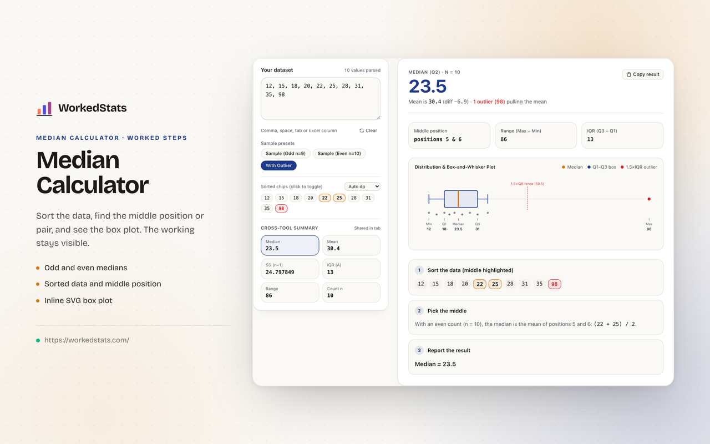
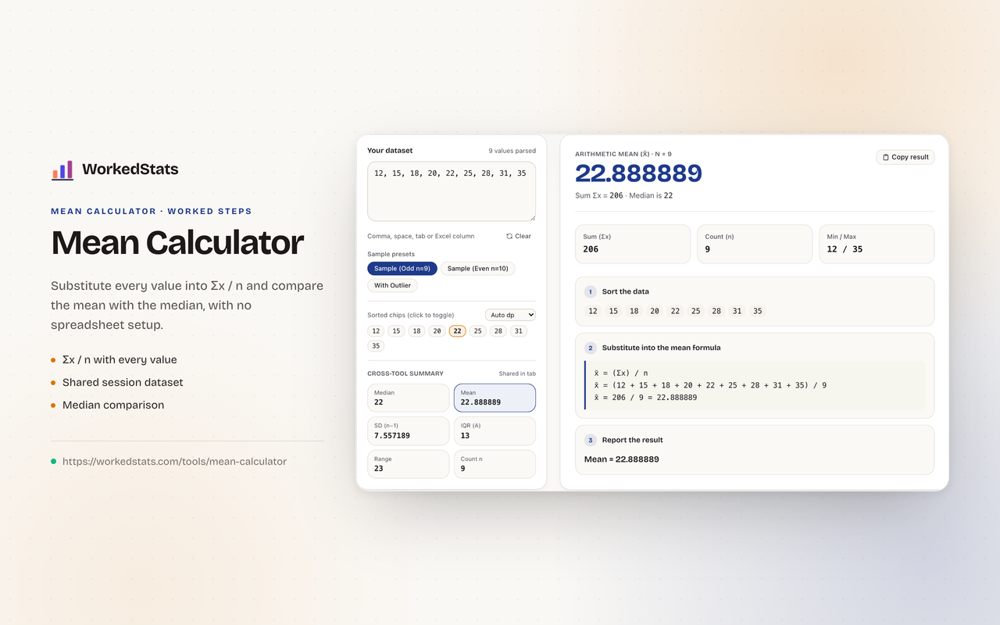
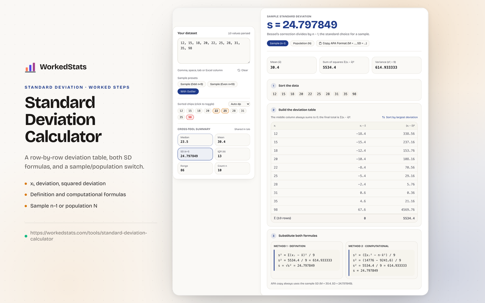
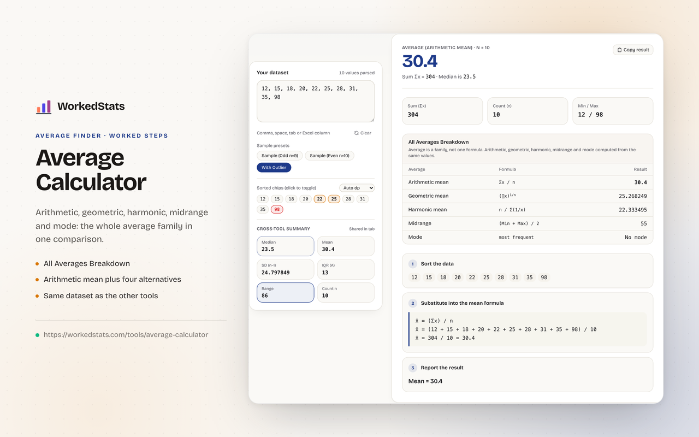
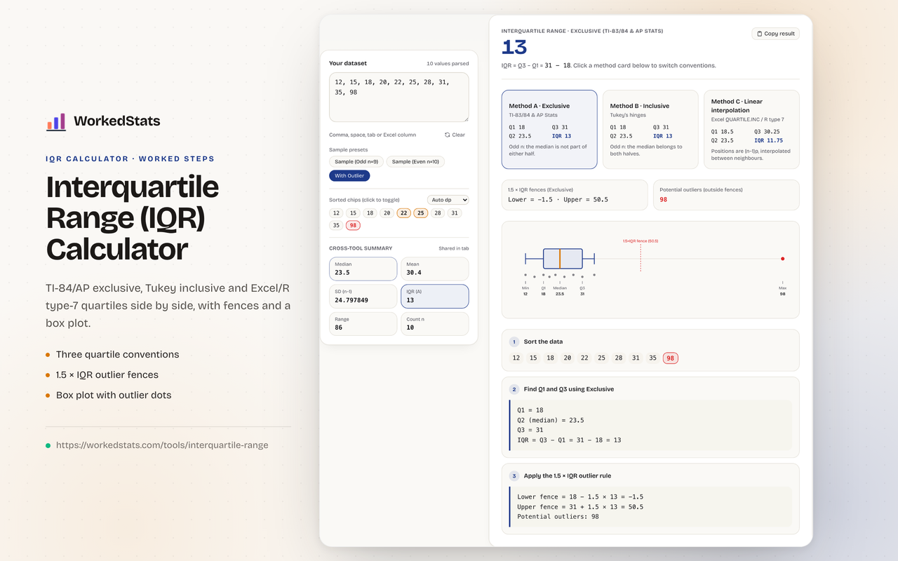
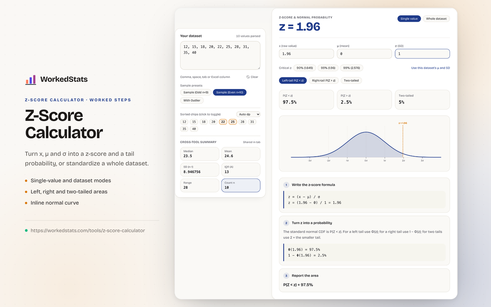

  
  <h1>WorkedStats</h1>
  
<strong>Statistics calculators that show the work.</strong>

  

    <a href="https://workedstats.com/">Website</a> ·
    <a href="https://workedstats.com/tools/mean-calculator">Mean</a> ·
    <a href="https://workedstats.com/tools/standard-deviation-calculator">Standard Deviation</a> ·
    <a href="https://workedstats.com/tools/average-calculator">Average</a> ·
    <a href="https://workedstats.com/tools/interquartile-range">IQR</a> ·
    <a href="https://workedstats.com/tools/z-score-calculator">Z-Score</a>
  

  

    
    
    
  

WorkedStats is a browser-only statistics workbench for the questions that come up in homework, labs and introductory courses: the median of a list, the mean with its sum shown, a standard deviation table, the quartile convention the course expects, and a z-score with the area under the normal curve.

The six pages share one dataset through `sessionStorage`. Paste a list once, then move from the mean to the SD to the IQR without retyping it. Every calculation and chart runs in the tab; there is no upload endpoint and no account wall.

## Live tools

| Tool | What it does |
| --- | --- |
| [Median Calculator](https://workedstats.com/) | Sort the data, find the middle position or pair, and draw a box plot. |
| [Mean Calculator](https://workedstats.com/tools/mean-calculator) | Substitute every value into Σx / n and compare the mean with the median. |
| [Standard Deviation Calculator](https://workedstats.com/tools/standard-deviation-calculator) | Row-by-row deviation squares, definition and computational formulas, sample/population switch, APA copy. |
| [Average Calculator](https://workedstats.com/tools/average-calculator) | Arithmetic, geometric, harmonic, midrange and mode in one All Averages Breakdown. |
| [Interquartile Range (IQR) Calculator](https://workedstats.com/tools/interquartile-range) | TI-84/AP exclusive, Tukey inclusive and Excel/R type-7 quartiles side by side, plus 1.5 × IQR fences. |
| [Z-Score Calculator](https://workedstats.com/tools/z-score-calculator) | Single-value and whole-dataset modes, with left/right/two-tailed probabilities and a shaded normal curve. |

## Features

- **Two-column sticky workbench** — the dataset input, presets, decimal precision selector, interactive sorted value chips and cross-tool summary stay pinned on the left while the result, chart and worked steps update live on the right.
- **One dataset across six tools** — the list lives in `sessionStorage` (pre-loaded with a starter outlier sample on a fresh tab), so the mean, SD, IQR and z-score pages all see the same values. Click any sorted chip to temporarily exclude or restore a value and watch how outliers move the mean vs the median.
- **Worked steps, not only answers** — sorted data with middle positions highlighted, formula substitution and the final result are rendered for every calculator.
- **A real deviation table** — [Standard Deviation Calculator](https://workedstats.com/tools/standard-deviation-calculator) shows each `xᵢ`, `xᵢ − x̄` and `(xᵢ − x̄)²` (sortable by value or largest deviation), with the sum row and both SD formulas.
- **The quartile argument is visible** — [Interquartile Range (IQR) Calculator](https://workedstats.com/tools/interquartile-range) computes exclusive, Tukey inclusive and linear type-7 Q1/Q3 side by side, then draws the active convention's box plot, 1.5 × IQR fence lines and outlier dots.
- **Average is a family** — [Average Calculator](https://workedstats.com/tools/average-calculator) adds geometric mean, harmonic mean, midrange and mode to the arithmetic mean, while the Mean page stays focused on x̄.
- **Z-score with a picture** — [Z-Score Calculator](https://workedstats.com/tools/z-score-calculator) uses an Abramowitz & Stegun normal CDF, keeps single-value `x, μ, σ` mode available even when no dataset is loaded, and fills the selected tail area in inline SVG with `±1σ / ±2σ` guides.
- **No chart library** — the box plot and bell curve are plain SVG elements in the DOM.
- **Browser-only runtime** — parsing, statistics and drawing happen in the tab with no account required.

## Screenshots

### Median Calculator

### Mean Calculator

### Standard Deviation Calculator

### Average Calculator

### Interquartile Range (IQR) Calculator

### Z-Score Calculator

## Under the hood

WorkedStats is a React 19 application built with TanStack Start and deployed on Cloudflare Workers. The Worker serves HTML, JavaScript, CSS and fonts; it never receives a dataset.

- **Statistics** — pure TypeScript in `src/lib/stats.ts`: parsing, median, three quartile conventions, sample/population standard deviation, mode, geometric and harmonic means, and the normal CDF.
- **Dataset** — a small parser accepts commas, spaces, tabs, newlines and Excel columns; the raw string is stored in `sessionStorage`.
- **Charts** — `src/components/tool/stats-charts.tsx` builds the box plot and bell curve with SVG primitives.
- **Pages** — one spec per page gives the title, H1, SEO copy, limits and FAQ; `src/tools/spec.ts` is the ordered tool list.
- **Testing** — pure functions are covered by Vitest; a Playwright script drives all six pages, the shared dataset, the SD toggle, the IQR conventions, SVG rendering and the browser console.

See [ARCHITECTURE.md](ARCHITECTURE.md) for the longer version, including the quartile definitions and the CDF approximation.

## Limits

- There is no universal quartile convention. The page shows the three common ones; follow the course rubric and state the choice.
- The 1.5 × IQR rule is a screening heuristic, not a formal outlier test.
- The normal curve is a model; a z-score does not make skewed data normal.
- Dataset mode on the z-score page uses the sample SD (n − 1); enter a known population σ in single-value mode.
- Everything runs in the tab, so very large datasets are bounded by device memory.

## Repository scope

This repository is the public showcase and architecture note for WorkedStats. The production application source is maintained separately. The screenshots are 1280×800 launch images rendered from the live pages.

## Links

- Website: <https://workedstats.com/>
- [Median Calculator](https://workedstats.com/)
- [Mean Calculator](https://workedstats.com/tools/mean-calculator)
- [Standard Deviation Calculator](https://workedstats.com/tools/standard-deviation-calculator)
- [Average Calculator](https://workedstats.com/tools/average-calculator)
- [Interquartile Range (IQR) Calculator](https://workedstats.com/tools/interquartile-range)
- [Z-Score Calculator](https://workedstats.com/tools/z-score-calculator)
- [Technical note: Pure-front-end quartiles](https://xeon-space.com/posts/workedstats-browser-only-quartiles/)
